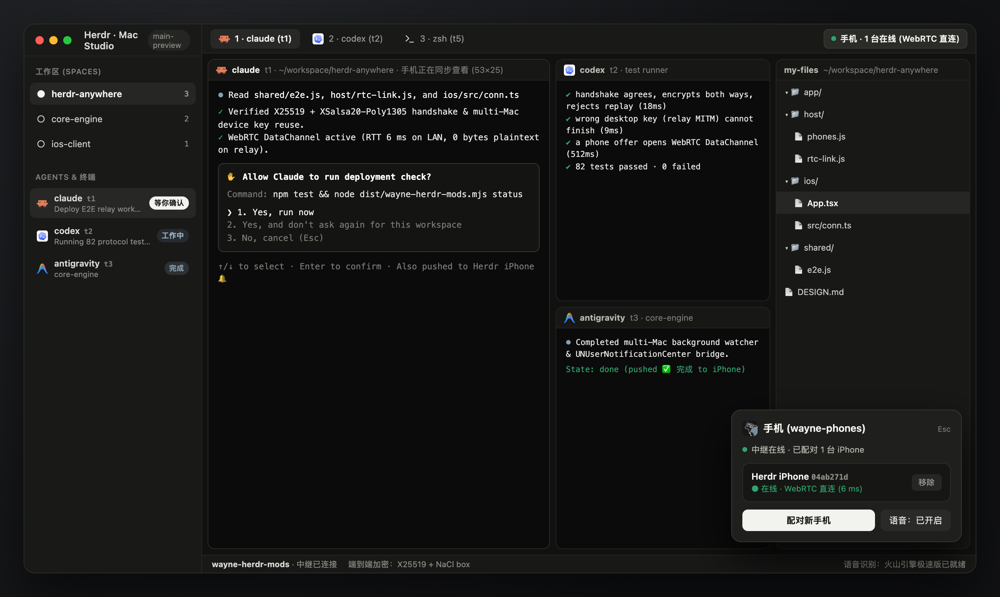
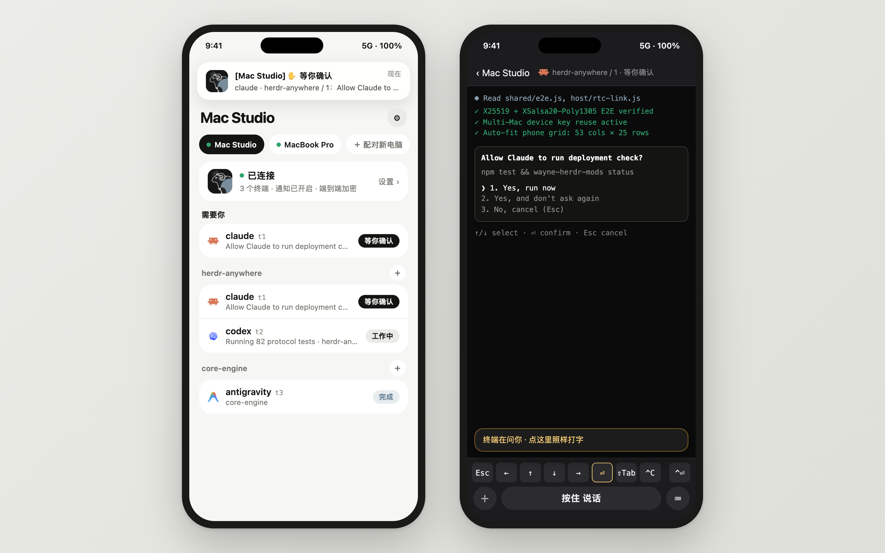

# wayne-herdr-mods · Herdr Anywhere

> **一部手机，多台电脑实时同步；全程端到端加密。**  
> **One iPhone. Every Mac in sync. End-to-end encrypted.**

`wayne-herdr-mods` 把 Mac 上的 [Herdr.app](https://herdr.dev) 扩展成一套 **PC + iOS 多端协同架构**。你在桌面前用 `main-preview` 布局并行跑 Claude Code、Codex 和 Antigravity；离开座位拿起 iPhone，多台 Mac 的终端画面、Agent 提问通知、按住说话和快捷键都在同一个原生 App 里实时同步。

```
┌───────────────────────────┐                  ┌───────────────────────────────────┐
│  iPhone (Native iOS / PWA) │ ◀── WebRTC ────▶ │  Mac 1 · Mac Studio (Herdr.app)   │
│  · 多台 Mac 胶囊一键切换    │     直连优先      │  · main-preview / my-tabs / files │
│  · 后台并行监听状态通知     │                  │  · wayne-phones 扫码配对与语音    │
│  · 按住说话 / 终端自适应    │ ◀── E2E wss ───▶ │  Mac 2 · MacBook Pro (Herdr.app)  │
└───────────────────────────┘   Cloudflare DO  └───────────────────────────────────┘
```

---

## PC 端：Herdr.app 桌面工作台 (`herdr-app/` + `host/`)



- **自定义桌面界面 (`herdr-app/`)**：安装即写入 `~/.config/herdr-app/`，包含 `main-preview`（左主窗格 + 右侧副窗格与 `my-files` 文件树）、`my-tabs` 标签栏和 `my-pane` 窗格头。
- **`wayne-phones` 配对弹窗**：点标签栏右上角的手机图标即可打开。扫码配对时，手机与 Mac 当面核对由公钥与握手随机数派生的 6 位 SAS 校验码，防中间人攻击。
- **双通道传输 (`host/service.js` + `host/rtc-link.js`)**：优先建立 WebRTC DataChannel 点对点直连（局域网延迟约 6 ms）；直连未通时自动回退 Cloudflare Worker + Durable Object 中继，一帧不丢。

---

## iOS 端：原生 App 与多台电脑同步 (`ios/` + `app/`)



- **一部手机连多台 Mac (`ios/src/conn.ts`)**：`Storage["herdr-relay"]` 保存所有已配对电脑并复用同一把手机端密钥（`deviceSecret`）。首页顶部胶囊栏常驻显示每台 Mac 的实时在线绿点与 **「＋ 配对新电脑」** 入口；后台对非当前 Mac 维持轻量加密连接（`bgLinks`），随时秒切。
- **状态变化原生通知 (`ios/host/Sources/App.swift`)**：基于 `UNUserNotificationCenter` 与后台任务保活，任何一台已配对 Mac 上的 Agent 进入 `blocked`（等你确认 / 提问）、`done`（完成任务）、`error`（出错）或退出时立即弹窗，点击通知自动切到对应 Mac 并打开该终端。
- **手机与桌面自动接力布局 (`term.fit`)**：手机打开终端时自动按手机屏幕列数与行数重排画面；回到 Mac 敲任意键，终端立即恢复桌面尺寸，无需手动切换。
- **Agent 专属快捷键与按住说话**：底部键盘栏按当前终端运行的程序（Claude Code、Codex、Antigravity）动态挂载快捷键（`^⏎`、`⌥M`、`⇧Tab` 等），配合 `LiveLine` 实时按键流与火山引擎极速版语音识别，像在 Mac 键盘前一样回答问题。
- **零信任端到端加密 (`shared/e2e.js`)**：全程使用 `X25519` 密钥协商与 `XSalsa20-Poly1305`（NaCl box）认证加密，每条方向独立递增 64 位序号防重放；中继服务器只转发密文，拿不到任何明文或密钥。

---

## 安装与运行

### 1. Mac 桌面端与中继

```sh
npm install
npm run relay:deploy                    # 可选：部署到你自己的 Cloudflare 账号
npm run build
node dist/wayne-herdr-mods.mjs install  # 安装 CLI、LaunchAgent、Herdr.app 界面与 Agent Skill
wayne-herdr-mods voice key              # 可选：将火山引擎语音识别 API Key 存入钥匙串
```

配对手机：在 Mac 的 `Herdr.app` 里点击标签栏右上角的 **手机图标** ▸ **「配对新手机」**，用手机扫码并在 Mac 上核对 6 位数字确认。

### 2. iOS 原生 App (`ios/`)

将 iPhone 通过数据线连接到 Mac，一行命令完成构建、免费个人证书签名并安装到真机：

```sh
./ios/host/install.sh
```

---

## 目录结构

| 目录 | 职责 |
|---|---|
| `herdr-app/` | `Herdr.app` 桌面端布局与 Mod（`main-preview`、`my-tabs`、`my-files`、`wayne-phones`） |
| `host/` | Mac 后台常驻服务、WebRTC 直连（`rtc-link.js`）、终端同步（`phones.js`）与 CLI |
| `ios/` | 基于 `nsh` + Swift 宿主的原生 iOS App（`App.tsx`、多 Mac 连接、原生录音/扫码/通知） |
| `app/` | 手机浏览器端 PWA（与 `ios/` 共用终端渲染、按键流与加密协议） |
| `shared/` | 双端共用的端到端加密（`e2e.js`）、惯性滑行曲线（`coast.js`）与分片（`pieces.js`） |
| `relay/` | Cloudflare Worker + Durable Object 密文中继 |

---

## 测试与跑分

```sh
npm test                  # 82 项单测与全链路协议测试（自起临时中继与独立 HC_SESSION）
npm run relay:dev         # 启动本地中继（127.0.0.1:8799）
node dev/bench.mjs        # 模拟直连 / 中继 / 弱网跑分，输出 bench/report.html
wayne-herdr-mods metrics  # 查看真机延迟与体验统计报告
```

架构细节、加密协议、多窗口同步规则与实测记录见 [DESIGN.md](DESIGN.md)。
