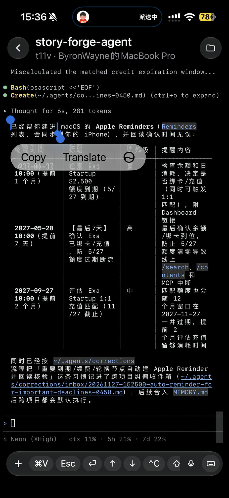
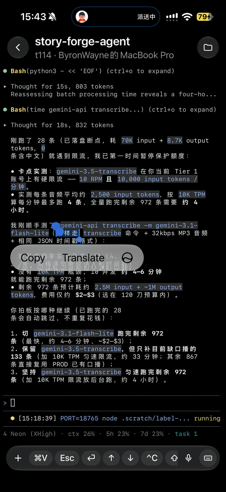
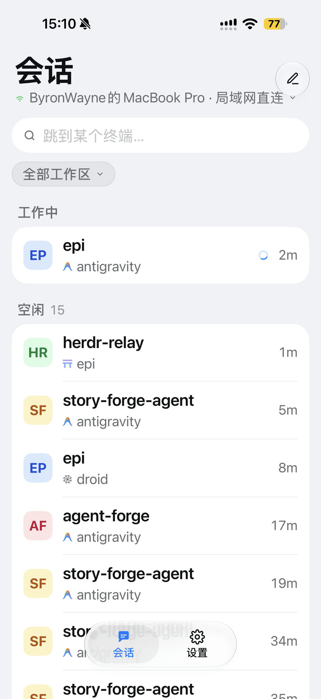

## 现象（用户 2026-11-27 两次真机截图确认，仍未解决）
在终端里长按文字，终端自己的选区（蓝色高亮 + 起止拖动手柄）正常，但**还会弹出 WebView 自带的
Copy/Translate 菜单**，而不是我们接的系统菜单（`SelectionMenu` 的 复制/全选/打开链接）。用户原话
「会出现两个那个选中的文本框，感觉有 bug 了」「我感觉还是有」。

证据（用户截图，已存仓库）：
- 
- 
- 改之前我们自绘的「复制」操作条：

## 已经试过、都没用
1. `ios/build-term.mjs`：`#host { user-select: none }`（commit `0867454`）。
2. 发现 `node_modules/@xterm/xterm/css/xterm.css` 的 `.xterm-accessibility-tree { user-select: text }`
   覆盖了它，又加 `.xterm .xterm-accessibility-tree { user-select: none !important; touch-callout: none }`，
   并在 Swift 侧 `viewDidLayoutSubviews` 里递归把每个 `WKWebView` 的
   `configuration.preferences.isTextInteractionEnabled = false`（commit `74795ef`）。**用户实测仍然出现。**

## 下一步怀疑点（未验证）
- nsh 的 `<WebView>` 可能不是 `NshAppView` 的子视图（或在另一个 window/presented controller 里），
  所以 `disableWebTextInteraction(in: app)` 根本没碰到它。先打印/遍历确认那个 WKWebView 的真实位置。
- `isTextInteractionEnabled` 在 iOS 27 上对已经创建的 WKWebView 可能不生效；需要在 nsh 创建 WebView
  之前就设置（nsh 侧配置），或直接禁用它的 `UILongPressGestureRecognizer` / `WKContentView` 的
  `textInteraction`。
- 也可能这个 Copy/Translate 菜单不是 WKWebView 的，而是 `UIEditMenuInteraction` 在我们没给
  `menuFor` 时回退到系统默认动作——检查 `SelectionMenu` 的 delegate 是否真的被调用（加日志）。

## verify
- 真机长按一段终端文字：只出现终端选区 + 我们的系统菜单（复制/全选/打开链接），**不再出现
  Copy/Translate**。
- 复制、全选、打开链接三个动作都真的生效；点空白处选区和菜单都消失。
